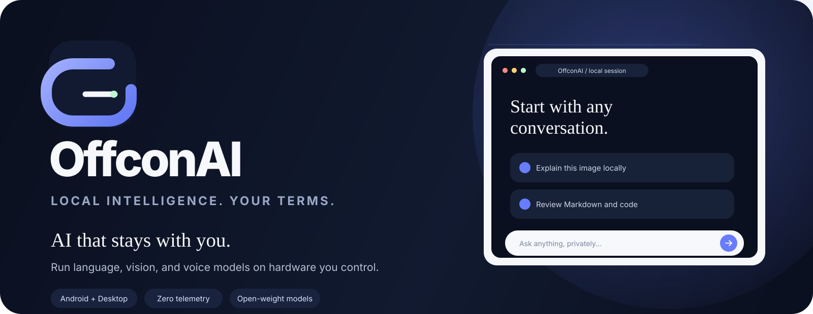
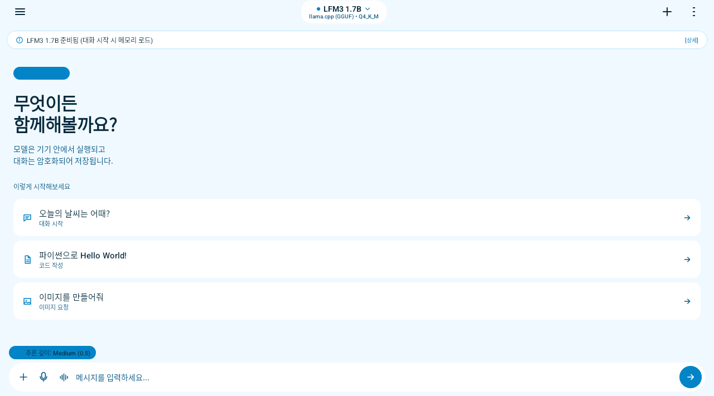
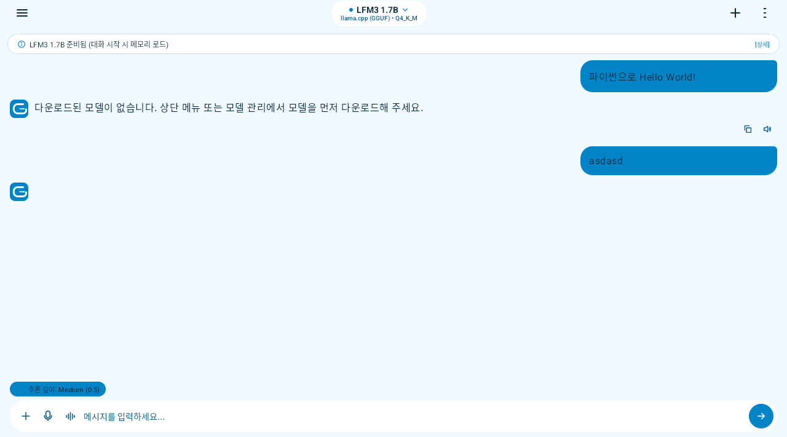
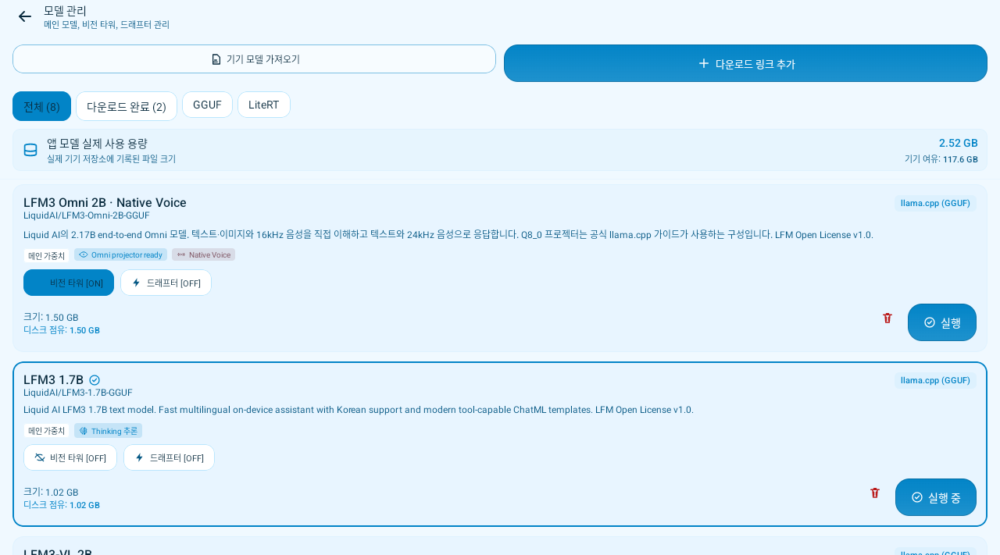
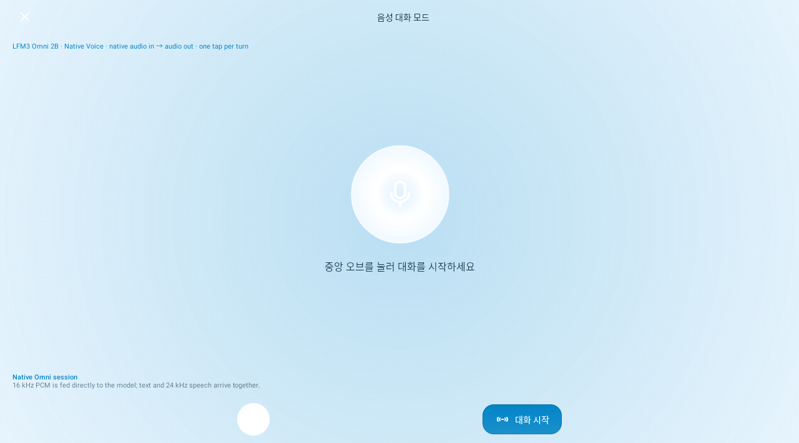

  

  
  
  
  
  
  
  
  
  

<h1 align="center">OffconAI — 곁에 머무는 AI.</h1>

  <strong>Android와 데스크톱을 위한 오프라인 LLM 앱.</strong> 
  llama.cpp와 LiteRT-LM으로 GGUF 언어·비전·네이티브 음성 모델을 실행하고, 온디바이스 문서 RAG와 MCP 도구, Ollama/OpenAI 호환 API까지 직접 보유한 하드웨어에서 사용하세요. 계정도, 텔레메트리도, 클라우드 왕복도 없습니다.

  <a href="#install"><b>다운로드</b></a> ·
  <a href="#feature-tour">화면</a> ·
  <a href="#models">모델</a> ·
  <a href="https://zmxnpquryet-gif.github.io/OffconAI/"><b>웹사이트</b></a> ·
  <a href="README.md">English</a> ·
  <a href="README.zh-CN.md">中文</a>

  
  
  

## 왜 OffconAI인가?

- **기본이 오프라인.** 모델, 프롬프트, 대화, RAG 인덱스, 음성이 모두 기기에 남습니다. 네트워크는 직접 선택할 때만 사용합니다.
- **내 모델을 그대로.** llama.cpp GGUF와 LiteRT-LM 번들, 비전 프로젝터와 네이티브 Omni 오디오까지 지원합니다.
- **클라우드 AI의 사적 대안.** 계정도, 분석도, 호스팅 모델도 없습니다.
- **채팅 그 이상.** OCR 문서 RAG, 호출별 승인 MCP 도구, 로컬 STT/TTS, 포트 11434의 Ollama/OpenAI 호환 API.

## 구조적으로 로컬

OffconAI는 프롬프트, 대화, 모델 파일과 생성을 기기에 유지합니다. 네트워크는 모델을 직접 다운로드하거나, MCP 서버에 연결하거나, 선택 사항인 로컬 API를 공개할 때만 사용됩니다.

| 영역 | OffconAI의 방식 |
| --- | --- |
| **텍스트 추론** | llama.cpp GGUF 및 LiteRT-LM, 명시적인 CPU 폴백 지원 |
| **네이티브 음성** | LFM3 Omni를 llama.cpp/libmtmd로 실행: 16kHz PCM 입력, 텍스트와 24kHz PCM 출력 |
| **파이프라인 음성** | 텍스트·비전 모델을 위한 기기 내 Whisper STT → LLM → TTS |
| **대화 저장** | Android Keystore 기반 AES-256-GCM 암호화 |
| **로컬 API** | 포트 11434의 Ollama 및 OpenAI 호환 서버 |
| **도구 호출** | 구조화된 파싱과 호출별 승인을 지원하는 MCP 클라이언트 |
| **데스크톱** | 서로 독립적인 llama.cpp, vLLM 및 Strata 어댑터 |

## 긴 대화를 위해 다듬은 차분한 인터페이스

| 홈 | 대화 | 네이티브 음성 |
| :---: | :---: | :---: |
|  |  |  |

- **하나의 입력창, 분명한 동작.** 대화에서 벗어나지 않고 이미지를 첨부하고, 받아쓰고, 음성 모드로 전환하거나 메시지를 보낼 수 있습니다.
- **테마 전체에 반영되는 색상.** 강조색을 바꾸면 로고, 말풍선, 포커스 링, 컨트롤과 상태 표시에 함께 적용됩니다.
- **스트리밍에 맞춘 렌더링.** Markdown, 구문 강조 코드, 표, 링크와 읽기 쉬운 수식을 원시 HTML을 실행하지 않고 표시합니다.
- **실제 런타임 정보.** TPS, 프롬프트 처리 속도, 컨텍스트 사용량, 모델 형식과 가속 상태는 현재 백엔드에서 가져옵니다.
- **반응형 레이아웃.** 콘텐츠 폭을 휴대폰, 태블릿, 폴더블과 Windows Subsystem for Android에서도 읽기 좋게 유지합니다.

## 막다른 길이 없는 모델 카탈로그

| 모델군 | 크기 | 강점 |
| --- | --- | --- |
| **LFM3 Omni** | 2B | 네이티브 오디오와 이미지 입력, 텍스트 및 음성 출력 |
| **LFM3 / LFM3-VL** | 1.7B · 2B | 소형 다국어 텍스트 및 비전 |
| **Qwen 3.5** | 0.8B · 2B · 4B | 추론, 비전, 도구 사용, 한국어 지원 |
| **Gemma 4 E2B / E4B** | 기기 친화적 | 메모리가 넉넉한 기기를 위한 공식 QAT GGUF 빌드 |

호환 모델은 직접 URL, HTTPS 미러, Hugging Face 저장소 또는 로컬 파일로 추가할 수 있습니다. 본체 가중치, 프로젝터, 드래프터와 프롬프트 템플릿은 각각 독립적으로 설정합니다. Hugging Face 자격 증명은 제3자 미러로 전달되지 않습니다. 정확한 파일, 크기와 라이선스는 [모델 카탈로그](docs/MODEL_CATALOG.md)에서 확인하세요.

## 중계 서버 없는 네이티브 음성

LFM3 Omni 2B는 앱의 네이티브 오디오 경로에 연결되어 있습니다.

- 16kHz 모노 PCM을 멀티모달 프로젝터로 인코딩합니다.
- 오디오를 언어 모델이 직접 평가합니다.
- 네이티브 오디오 헬퍼가 동기화된 텍스트와 24kHz PCM 음성을 출력합니다.
- 음성 화면에서 이 경로를 별도의 Whisper STT 파이프라인과 구분해 표시합니다.

현재 네이티브 모드는 한 번 눌러 녹음을 시작하고 다시 눌러 한 턴을 제출하는 방식입니다. 연속 양방향 입력과 실제 ARM 기기의 지연 시간은 아직 검증 대상이며, 앱은 이를 완성된 기능으로 표현하지 않고 한계를 명시합니다.

## 들여다볼 수 있는 런타임 위에서

| Android | 데스크톱 |
| --- | --- |
| llama.cpp, LiteRT-LM, libmtmd | 네이티브 Rust + Slint 애플리케이션 |
| GGUF 및 LiteRT 모델 형식 | 독립적인 llama.cpp, vLLM 및 Strata 어댑터 |
| CPU 폴백과 기능 감지 | LLM Edition 및 All-in-One Edition |
| 명시적인 상태 코드를 쓰는 JNI 브리지 | 백엔드별 설정과 리소스 모니터링 |

아키텍처 자세히 보기: [Android 및 플랫폼 아키텍처](docs/ARCHITECTURE.md) · [데스크톱 백엔드](docs/desktop.md).

## 프라이버시 제어

- 대화와 자격 증명은 Android Keystore 기반 AES-256-GCM으로 암호화됩니다.
- 선택 사항인 API 서버는 기본적으로 루프백에만 바인딩되며 생성된 베어러 토큰을 요구합니다.
- 텔레메트리나 분석 도구가 포함되어 있지 않습니다.
- 도구 호출은 승인 전까지 멈추며, 출력은 신뢰할 수 없는 외부 데이터로 취급합니다.
- OOM Guard는 모델을 불러오기 전에 가중치, KV 캐시와 연산 버퍼를 추정합니다.

## 시작하기

### 설치

[최신 릴리스](https://github.com/zmxnpquryet-gif/OffconAI/releases/latest)를 내려받고 브라우저 또는 파일 관리자에서 설치를 허용한 다음, 모델 관리자에서 모델을 선택하세요.

### 빌드

~~~bash
git clone --recurse-submodules https://github.com/zmxnpquryet-gif/OffconAI.git
cd OffconAI
./gradlew assembleDebug
./gradlew testDebugUnitTest
~~~

필요 환경: JDK 17, Android SDK 36, NDK 27, arm64-v8a 또는 x86_64 기기. 네이티브 llama.cpp 서브모듈은 LFM3 지원을 위해 업스트림 v0.8.0에 고정되어 있습니다.

### 로컬 API

~~~bash
curl http://<phone-ip>:11434/v1/models \
  -H "Authorization: Bearer <local-api-key>"
~~~

서버는 Ollama `/api/*`와 OpenAI 호환 `/v1/*` 엔드포인트를 제공합니다. LAN 바인딩은 직접 켜야 하며, LAN의 HTTP 트래픽은 암호화되지 않습니다.

## 프로젝트 구조

~~~text
app/       Android UI, llama.cpp/LiteRT 런타임, 음성, 저장소, API 서버
desktop/   네이티브 Rust + Slint 데스크톱 워크스페이스와 독립 백엔드 어댑터
docs/      아키텍처, 모델 카탈로그, UI 방향, GitHub Pages
~~~

## OffconAI에 별을

OffconAI가 구독료를 아껴주거나 사적인 대화를 지켜준다면 [저장소에 별을 눌러 주세요](https://github.com/zmxnpquryet-gif/OffconAI/stargazers). 별은 더 많은 사람이 로컬 AI를 찾는 데 도움이 됩니다.

## 기여하기

아키텍처나 인터페이스 패턴을 바꾸기 전에 [CONTRIBUTING.md](CONTRIBUTING.md)와 [docs/UIUX.md](docs/UIUX.md)를 읽어 주세요. 변경 사항은 오프라인 동작을 유지하고, 수행한 검증을 밝히고, 런타임이 입증할 수 없는 기능을 주장하지 않아야 합니다.

## 라이선스

Apache License 2.0. 모델 파일은 별도로 다운로드하며 각 모델의 라이선스를 따릅니다.
