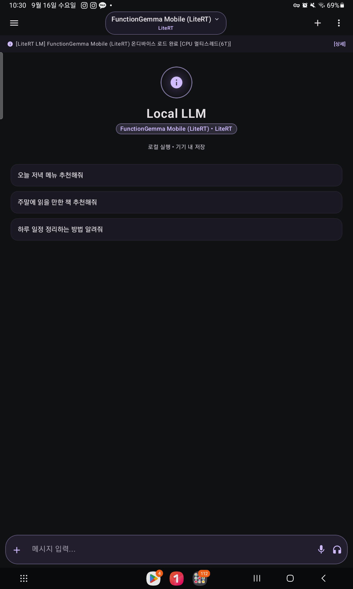
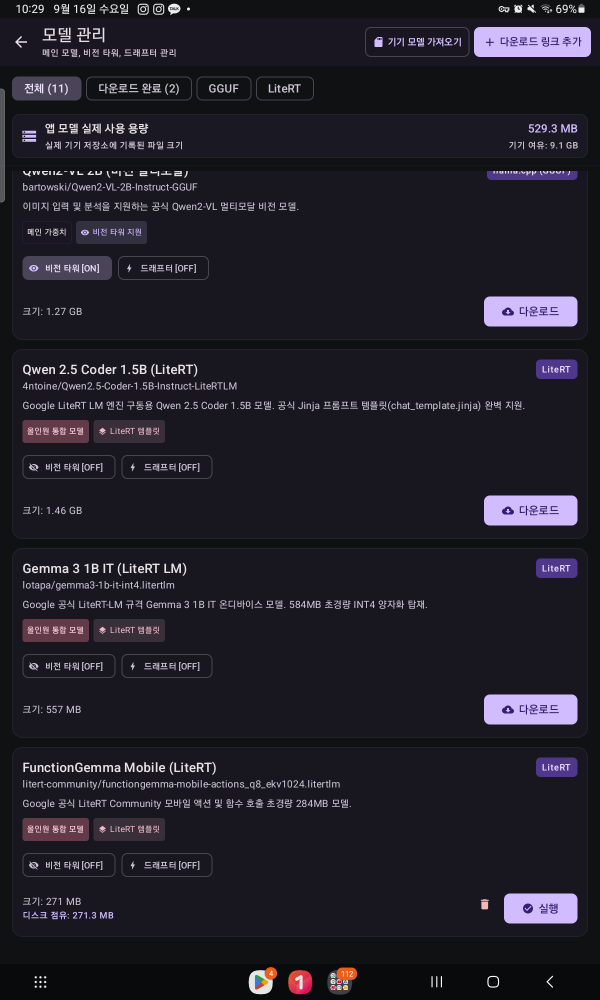
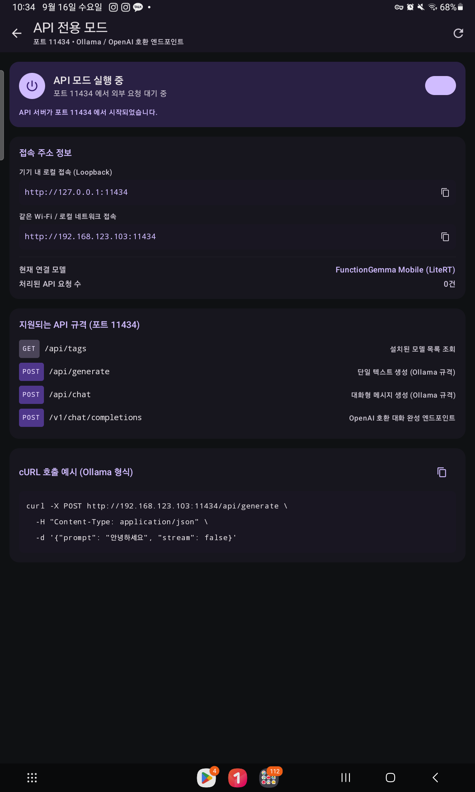
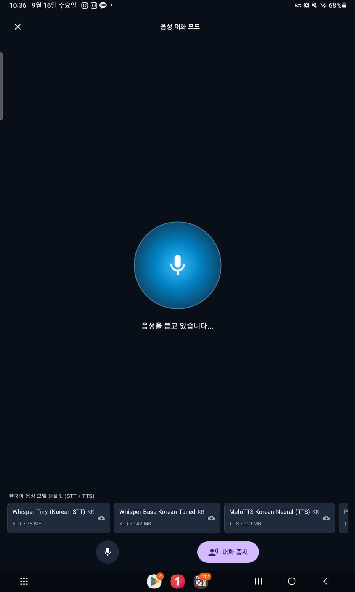

# Local LLM Android

<p align="center">
  
  
</p>

<p align="center">
  <a href="README.md">English</a> | <strong>한국어</strong> | <a href="README.zh-CN.md">中文</a>
</p>

<p align="center">
  <a href="https://github.com/zmxnpquryet-gif/Localllmandroid/actions/workflows/android.yml"></a>
  
  
  
  
  
  
  
</p>

완전 오프라인 환경에서 동작하는 고성능 안드로이드 온디바이스 LLM(대형 언어 모델) 애플리케이션입니다. 외부 클라우드나 API 통신 없이 모델을 기기 안에서만 구동합니다 — 기본은 CPU 연산이며, 기기와 런타임이 지원하는 경우 GPU/NPU 가속을 사용하고 자동으로 CPU로 폴백합니다. UI는 자체 개발 **글래스 디자인 시스템** 위에서 동작하며 설정에서 **영어/한국어 실시간 전환**이 가능하고, 채팅에서 도구 호출을 위해 네이티브 **MCP 클라이언트**를 지원합니다. 또한 자체 MoE 연구 엔진(**SDengine**)이 `:engine` 모듈로 오픈소스로 개발 중입니다.

---

## 📱 스크린샷 갤러리

| 온디바이스 채팅 & 추론 지표 | 모델 허브 & 백엔드 관리 |
| :---: | :---: |
|  |  |
| **Ollama / OpenAI 호환 API 서버** | **실시간 음성 대화 모드** |
|  |  |

---

## 🏛️ 하이브리드 이원화 런타임 아키텍처

Local LLM Android는 단일 엔진에 종속되지 않고, **llama.cpp**와 **Google LiteRT-LM** 두 가지 런타임을 모두 지원하는 하이브리드 엔진 아키텍처를 채택하고 있습니다.

```
                  ┌────────────────────────────────────────┐
                  │            MainViewModel               │
                  └───────────────────┬────────────────────┘
                                      │
                         ┌────────────┴────────────┐
                         │        LlmEngine        │
                         └──────┬────────────┬─────┘
                                │            │
                ┌───────────────┘            └───────────────┐
                ▼                                            ▼
      [ llama.cpp 런타임 ]                          [ Google LiteRT-LM 런타임 ]
   • GGUF 양자화 포맷 폭넓게 지원                  • 구글 모바일 최적화 바이너리
     (Q4_K_M, Q8_0, K-quants 등)                    • Gemma-2, 모바일 NPU 가속 타깃
   • Qwen, DeepSeek-R1, Llama 3 등                 • 지원 기기에서 GPU/NPU 가속
   • CPU 멀티스레딩 & GPU 레이어 오프로딩             (자동 CPU 폴백)
   • mmproj 비전타워 연동 (멀티모달)               • 저전력 / 고효율 모바일 추론

        (+ SDengine — :engine 모듈의 실험적 자체 MoE 엔진, 아래 참조)
```

### 왜 두 엔진을 함께 사용하는가? (Dual-Runtime Rationale)

1. **폭넓은 모델 생태계 호환성 (llama.cpp GGUF)**
   - 허깅페이스(Hugging Face)에 존재하는 수만 개의 오픈소스 커뮤니티 GGUF 양자화 모델(Q4_K_M, Q8_0 등)을 즉시 다운로드하여 실행할 수 있습니다.
   - DeepSeek-R1 등의 추론(Reasoning) 모델, GGUF 채팅 템플릿, 멀티모달 mmproj 비전 타워가 같은 런타임에서 동작합니다.

2. **안드로이드 네이티브 하드웨어 가속 (Google LiteRT-LM)**
   - Google의 온디바이스 AI 런타임으로 모바일 SoC(Snapdragon, MediaTek, Tensor, Exynos)의 GPU 및 NPU 델리게이트와 가장 긴밀하게 최적화되어 있습니다.
   - 전력 소모와 발열을 최소화하면서 고효율 추론을 제공합니다.

---

## 🌐 온디바이스 Ollama / OpenAI 호환 API 서버 (포트 11434)

안드로이드 폰이나 태블릿을 독립적인 **Ollama 호환 로컬 AI 서버**로 활용할 수 있습니다.

- **표준 엔드포인트 지원**:
  - `GET /api/tags` - 다운로드된 온디바이스 모델 카탈로그 조회
  - `POST /api/generate` - 단일 텍스트 생성 (Ollama 규격)
  - `POST /api/chat` - 대화형 메시지 생성 (Ollama 규격)
  - `POST /api/show` - 활성 모델 상세 정보
  - `GET /api/version` - 서버 버전 (Ollama 호환 `0.5.1` 보고)
  - `POST /v1/chat/completions` - OpenAI SDK 및 클라이언트 호환 엔드포인트
  - `GET /v1/models` - OpenAI 모델 목록
  - 프로토콜 참고: 연결당 요청 1개(`Connection: close`), 요청 본문은 `Content-Length` 필수(chunked 요청 본문은 `411`로 응답).
- **네트워크 보안 및 외부 LAN 접근 제어**:
  - **로컬 루프백(`127.0.0.1`) 격리**: 기기 내부 앱 간 통신을 위한 기본 보안 모드.
  - **외부 네트워크(LAN) 접근 토글**: 토글 활성화 시 `0.0.0.0`으로 바인딩되어 동일 Wi-Fi의 PC, Mac, 개발 환경에서 안드로이드 기기로 직접 API 호출 가능.
  - **무작위 API 토큰 인증**: 최초 1회 생성되어 기기에 저장되는 Bearer API 키로 무단 접근 차단 (API 화면에서 재발급 가능). TLS 없음: LAN에서는 평문 HTTP이므로 신뢰 네트워크나 SSH 터널 사용.
  - **포그라운드 서비스**: 앱을 닫아도 서버 유지 (알림의 중지 버튼으로 종료), 프로세스 종료 시 함께 종료.
- **cURL 호출 예시**:
  ```bash
  curl -X POST http://<기기_IP>:11434/api/generate \
    -H "Authorization: Bearer <API_KEY>" \
    -H "Content-Type: application/json" \
    -d '{"prompt": "안녕하세요", "stream": false}'
  ```

---

## 🔒 보안 아키텍처 (Security Design)

1. **Android Keystore 기반 AES-256-GCM 암호화 (`ChatCrypto`)**
   - 키는 `AndroidKeyStore` 내부에서 내보내기 불가로 생성하며 하드코딩 키로의 폴백은 없습니다(실패 시 종료). TEE/StrongBox 지원 여부는 기기마다 다르므로 주장하지 않고, `KeyInfo`로 읽어 `keyProtection()`으로 노출합니다(계측 테스트가 기기별 수준을 로그에 남김).
   - 인증 암호화(AEAD)에 행 바인딩을 적용합니다. 암호문에 대화/메시지 ID와 컬럼을 연관 데이터로 묶어, 다른 칸으로 복사된 암호문은 인증에 실패합니다. 현행 포맷은 `v2:`이며 구 포맷 행은 실행 시 제자리에서 업그레이드됩니다.
   - 토큰·키(HF 토큰, API 서버 키, MCP Bearer 토큰)는 Keystore 암호문으로만 저장합니다(`SecretPrefs`). 이전 버전의 평문 복사본은 다음 접근 시 단일 원자적 커밋으로 마이그레이션 후 삭제하고(모델 파일 토큰은 다음 저장 시 재암호화), 깨진 암호문은 살아남은 평문이 있으면 1회 복구 후 재암호화합니다. 그 외 복호 불가 값은 유효한 값으로 쓰지 않고 없는 것으로 취급합니다.

2. **오프라인 텍스트 추론 및 로컬 저장**
   - 텍스트 추론 과정의 대화 내역 및 프롬프트가 외부 서버나 클라우드로 일절 전송되지 않습니다.
   - 모든 대화 기록은 로컬 암호화 SQLite Room 데이터베이스에만 저장됩니다.
   - 참고: 음성 인식(STT)은 **로컬 Whisper STT 엔진**(`LocalSttEngine`)으로 온디바이스 처리되며, 음성 합성(TTS)은 온디바이스 **supertonic 한국어 신경망 음성**(`LocalTtsEngine`, HF에서 1회 다운로드)을 사용하고 기기 내장 음성 서비스로 폴백합니다.

---

## ⚡ 주요 기능 및 특징

- **실시간 성능 벤치마크 지표 산출**:
  - **llama.cpp(GGUF)**: `llamaCtx.tokenize()` 네이티브 토큰화 호출을 통해 실제 토큰 수 기반의 `promptSpeed`(초당 처리 토큰 수) 및 `tps`(생성 속도)를 측정.
  - **Google LiteRT-LM**: C++ 코어의 `conv.getBenchmarkInfo()` 네이티브 지표를 직접 연동하여 오차 없는 실시간 성능 표기.
- **핸즈프리 음성 대화 모드 (Interactive Voice Mode)**:
   - 음성 인식(**로컬 Whisper STT**, 온디바이스) → 온디바이스 LLM 추론 → 음성 합성(TTS) 루프 자동 수행.
  - 리액티브 Voice Orb 애니메이션 탑재.
- **스트리밍 추론 상태머신 (`ReasoningStreamParser`)**:
  - DeepSeek-R1 등 추론 모델의 `<think>`, `</think>` 태그가 토큰 스트리밍 단위로 쪼개져 수신되는 경우에도 버퍼 상태머신을 통해 생각 과정과 최종 답변을 안정적으로 분리 표기.
- **MCP 프로토콜 클라이언트 (`McpClient`)**:
  - Streamable HTTP 우선, 레거시 SSE 차선의 JSON-RPC 클라이언트입니다(양쪽 경로 모두 세션 ID 유지 + `notifications/initialized` 전송; 레거시 경로는 POST 응답으로 돌아오는 응답을 소비하며, 응답을 SSE 채널로만 스트리밍하는 서버는 지원하지 않습니다). 응답은 요청 ID로 매칭됩니다(오래되었거나 요청되지 않은 프레임은 무시). 응답 본문과 스트림 라인에 크기 상한이 있고, 도구 이름은 프롬프트에 들어가기 전에 정화(sanitize)됩니다. Bearer 토큰은 선택 사항이며 요청마다 재확인합니다. https 어디에나, 평문 http는 loopback/사설 LAN에만 전송하고(mDNS `.local` 제외 — 브로드캐스트로 풀리므로 https 필요), 한 서버용으로 저장된 토큰은 주소가 바뀌면 재입력 없이 재전송하지 않으며, 리다이렉트로 https가 http로 떨어지지 않습니다. 레거시 SSE의 타 오리진 endpoint는 거부하며 `Mcp-Session-Id`를 연결별로 추적합니다.
  - 도구는 프롬프트에 제시되고, 턴마다 하나의 `<tool_call>{"name": ..., "arguments": {...}}</tool_call>` 블록으로 호출합니다(연결된 서버가 광고한 이름만, 턴당 첫 호출만, 코드펜스 안 예시·닫히지 않은 블록은 호출 아님). 모든 호출은 승인 대화상자를 거치며(항상 허용 없음, 60초 무응답 자동 거부), 거절하면 도구 사용을 끝내고 연속 2회 문법 오류에도 끝냅니다. 메시지당 최대 3라운드, 요청은 비동기·취소 가능이라 중지 버튼이 서버에 고아 요청을 남기지 않습니다. 결과는 신뢰할 수 없는 `<tool_result>` 데이터로 감싸(모든 태그 변형 무력화) 호출 기록과 함께 도구 카드로 표시되고, 외부 데이터로 명시되어 다음 턴에 전달됩니다. 작은 로컬 모델이 도구를 잘 쓰는지는 모델에 따라 다릅니다.
- **자체 글래스 디자인 시스템 (`ui/glass`)**:
  - Material3를 완전히 제거하고 자체 글래스 UI 툴킷(`GlassTheme`, `GButtons`, `GControls`, `GOverlays` 등)으로 모든 화면을 커버합니다.
- **인앱 다국어 UI (영어 / 한국어 / 중국어)**:
  - 설정에서 시스템 기본값 / English / 한국어 / 中文을 앱 재시작 없이 즉시 실시간 전환합니다.
- **안드로이드 인지 OOM 보호 가드**:
  - 모델 매핑 전 실제 필요 메모리(가중치 + KV 캐시 + 연산 버퍼)를 추정하여, OOM 킬로 밀려 들어가는 대신 컨텍스트 길이를 자동으로 낮춥니다.
  - 추론마다 in-flight 마커를 기록합니다. 다음 실행에서 마커가 남아 있으면 이전 프로세스가 추론 중 강제 종료된 것이므로 사고로 기록하고 다음 실행의 메모리 사용이 큰 설정을 자동으로 낮춥니다 (설정 화면에서 로그·사고 이력 확인 가능).
  - 생성 중 가용 RAM을 주기적으로 확인해 위험 수준이면 앱이 죽기 전에 생성을 안전하게 중단합니다.
- **타입 안전한 전역 네비게이션 (`AppScreen`) & 시스템 제스처 핸들링**:
  - 모든 UI 화면 컴포넌트의 화면 전환을 `AppScreen` enum으로 관리하며, 서브 화면에서 시스템 뒤로가기 제스처 시 메인 채팅으로 자연스럽게 복귀.
- **탄력적 모바일 다운로더**:
  - 포그라운드 서비스 백그라운드 다운로드 + 중단된 다운로드는 파트 파일에서 이어받기(수동 일시정지 버튼은 없음). 허깅페이스가 게시한 해시(`X-Linked-ETag`, 리다이렉트 체인 추적)가 있으면 SHA-256 검증 — 불일치 시 파일 삭제 후 실패, 이미 받은 파일도 재검사(불일치면 재다운로드). 잘려서 끝난 전송은 완료로 등록되지 않습니다(파일 이동 전 바이트 수를 검증하고, 이어받기 파트는 사이드카가 원격 리비전과 일치함을 증명하지 못하면 폐기). 해시 미게시 파일은 가중치 포맷 검사만으로 완료하고 다운로드 카드에 미검증으로 표시합니다(작은 템플릿 파일은 그대로 수용).

---

## 🧪 SDengine — 실험적 자체 추론 엔진 (`:engine`)

독립 안드로이드 라이브러리 모듈로 자체 MoE 전용 추론 코어를 오픈소스로 개발하고 있습니다.

**범위(의도된 설계):** 안드로이드에서 동작하는 gated-expert Mixture-of-Experts 전용 (Kotlin/JVM 코어 + 포터블 C++ JNI 레퍼런스, NEON/GPU 커널은 예정). Dense 전용 모델 및 비-MoE 하이브리드는 범위 밖입니다.

**현재 포함된 것:**
- GGUF 리더 + 메타데이터 감지, BPE 토크나이저, 샘플러, KV 캐시 (`GgufReader`, `BpeTokenizer`, `Sampler`, `KvCache`)
- 양자화 가중치 디퀀터: Q4_0/Q4_1/Q5_0/Q5_1/Q8_0/Q8_1과 K-quants Q4_K/Q5_K/Q6_K — ggml 레퍼런스 레이아웃에 스펙 벡터로 고정 (`Quant`, `QuantTest`)
- 페이징 전문가 스트리밍: dense 가중치는 상한 내 상주 디코딩, expert 타일은 스토리지에 두고 `ExpertPager`로 스트리밍 — RAM보다 큰 MoE 모델도 디코딩 가능
- 아키텍처 매칭 RoPE (llama.cpp의 아키텍처별 표에 따라 NeoX half-split / NORM interleaved 선택, GGUF 아키텍처에서 결정)
- NDK 27 + CMake 기반 포터블 C++ JNI 레퍼런스 (`arm64-v8a`, `x86_64`): `dot()` 동등성 확인용이며 NEON은 아직 없음 — 실제 연산은 JVM 스칼라 커널
- 실제 MoE 가중치 기반 수치 검증 (HTTP range 스트리밍, 수동/야간 `RealMoETest` + `LOCALENGINE_MOE_URL`; 일반 CI에서는 실행 안 함)
- 야간 골든 하네스: 실제 MoE GGUF에서 그리디 생성이 llama.cpp와 토큰 단위로 일치해야 함 (`GoldenLogitTest` + `nightly-real-model.yml`; 야간/예약 전용, 일반 CI 아님)
- gated-expert GGUF 엔드투엔드 생성 — `SDEngineEndToEndTest`가 합성 MoE 모델로 로드·토큰 스트리밍·중단·상주 상한 거부까지 검증

**상태: TEST BUILD / 실험체 — 실행은 되지만 프로덕션 사용 금지.**
- 레퍼런스 스칼라 커널로 수학을 검증 중이며, NEON/GPU 커널이 다음 단계입니다. 그래서 실기기에서 실제 MoE 모델은 초당 한 자릿수 토큰 속도로 동작합니다.
- 가져온 모델의 기본값은 llama.cpp이며 SDengine은 모델별 런타임 오버라이드(모델 관리자)로만 선택하는 opt-in입니다. SDengine 로드가 실패하면 모델 없이 남는 대신 llama.cpp로 한 번 재시도하고, 엔진 어드바이저리(`SDEngine.ADVISORIES`)를 계속 표시합니다.

---

## 🛠️ 빌드 및 요구 사항

### 요구 사항
- Android Studio Ladybug 이상 / JDK 17
- Android SDK 36, Min SDK 24
- Android NDK 27.2 + CMake 3.22 이상 (`:engine` 모듈 빌드에 필요)
- NDK 지원 기기 (ARM64-v8a, x86_64)
- 네이티브 의존성 수동 설치 불필요: sherpa-onnx STT AAR(약 50MB)은 저장소에 커밋하지 않고, 빌드 전 Gradle `fetchSherpaAar` 태스크가 버전·SHA-256 고정값으로 자동 다운로드합니다.

### 빌드 명령어
```bash
# 디버그 컴파일
./gradlew compileDebugKotlin

# 단위 테스트 실행
./gradlew testDebugUnitTest

# 릴리즈 APK 빌드
./gradlew assembleRelease
```

### 릴리즈 서명

릴리즈 빌드는 debug 키로 서명되지 않습니다. 업로드 키스토어 자격증명을 환경 변수
(`KEYSTORE_PATH`, `STORE_PASSWORD`, `KEY_PASSWORD`, 선택 `KEY_ALIAS`)로 넘기거나, 로컬 빌드의
경우 저장소 루트의 gitignore 처리된 `keystore.properties`에 넣으세요:

```properties
storeFile=my-upload-key.jks
storePassword=...
keyAlias=upload
keyPassword=...
```

계측 테스트는 연결된 기기/에뮬레이터에서 실행합니다: `./gradlew connectedDebugAndroidTest`.

---

## 📄 라이선스 (License)

이 프로젝트는 [Apache License 2.0](LICENSE)에 따라 자유롭게 사용 및 배포할 수 있습니다.
