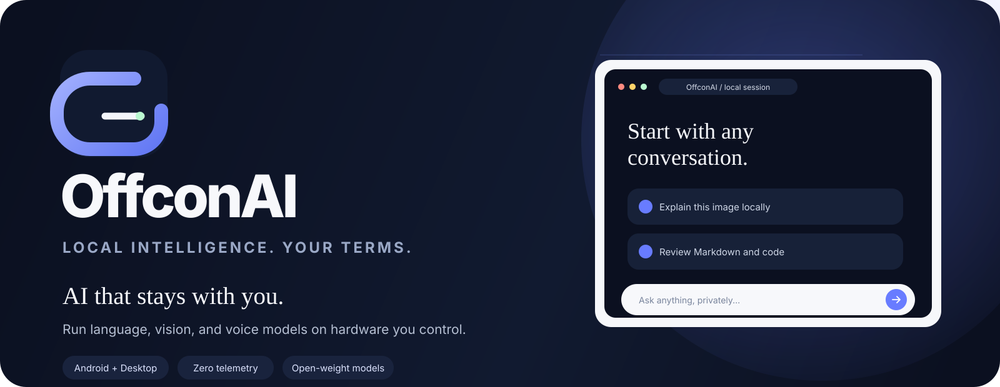
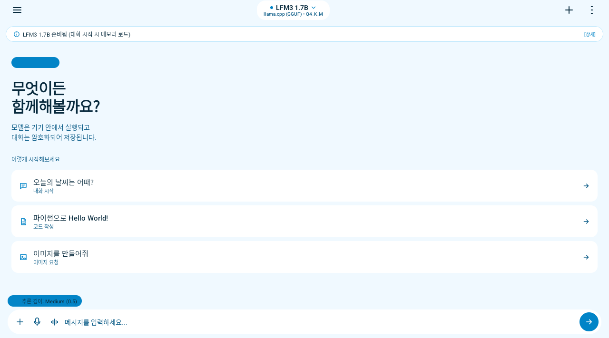
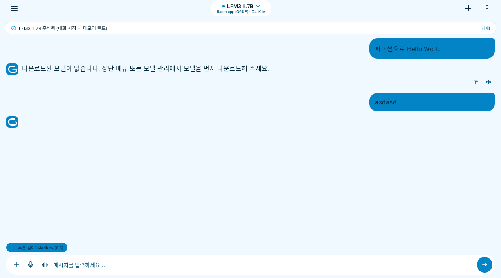
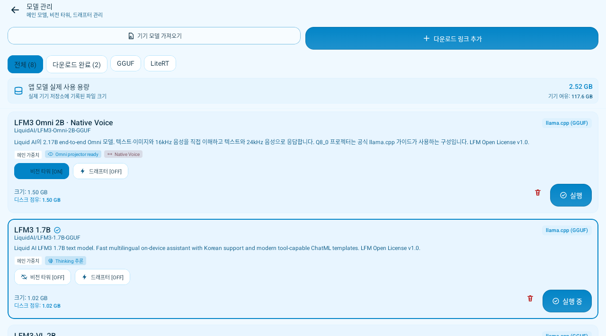
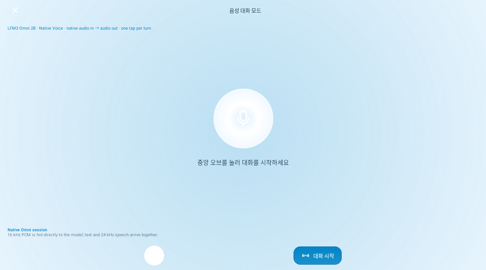

  

  
  
  
  
  
  
  

<h1 align="center">AI that stays with you.</h1>

  OffconAI is a local-first AI workspace for Android and desktop. 
  Run language, vision, and native voice models on your own hardware. No account required for inference.

  <a href="#install"><b>Download</b></a> ·
  <a href="#feature-tour">Screens</a> ·
  <a href="#models">Models</a> ·
  <a href="https://zmxnpquryet-gif.github.io/OffconAI/"><b>Website</b></a> ·
  <a href="README.ko.md">한국어</a> ·
  <a href="README.zh-CN.md">中文</a>

  
  
  

## Local by architecture

OffconAI keeps prompts, conversations, model files, and generation on the device. Network access is used only when you deliberately download a model, connect an MCP server, or expose the optional local API.

| Boundary | What OffconAI does |
| --- | --- |
| **Text inference** | llama.cpp GGUF and LiteRT-LM, with explicit CPU fallback |
| **Native voice** | LFM3 Omni runs through llama.cpp/libmtmd: 16 kHz PCM in, text plus 24 kHz PCM out |
| **Pipeline voice** | Text and vision models can use on-device Whisper STT → LLM → TTS |
| **Conversation storage** | AES-256-GCM encryption with Android Keystore |
| **Local API** | Ollama and OpenAI-compatible server on port 11434 |
| **Tool calls** | MCP client with five tool-call dialects and per-call approval |
| **Documents** | Encrypted on-device RAG for PDF, XLSX, PPTX and text, with OCR for scanned PDFs |
| **Memory control** | F16/Q8_0/Q4_0 KV cache and an optional OOM-guard bypass |
| **Desktop** | Independent llama.cpp, vLLM, and Strata adapters |

## A calm interface, built for long sessions

| Home | Conversation | Native voice |
| :---: | :---: | :---: |
|  |  |  |

- **One composer, clear actions.** Attach an image, dictate, enter voice mode, or send without leaving the conversation.
- **Theme-wide color changes.** Accent changes propagate to the logo, bubbles, focus rings, controls, and status states.
- **Streaming-friendly rendering.** Markdown, highlighted code, tables, links, and readable math render without executing raw HTML; trailing listings collapse into copyable artifact cards.
- **Documents stay searchable.** Imported files are chunked, embedded, and encrypted on-device; only the files you enable for a chat are retrieved into its prompt.
- **Live runtime truth.** TPS, prompt speed, context usage, model format, and acceleration state come from the active backend.
- **Responsive layout.** The content column stays readable on phones, tablets, foldables, and Windows Subsystem for Android.

## Model catalog without dead ends

| Family | Size range | Strengths |
| --- | --- | --- |
| **LFM3 Omni** | 2B | Native audio and image input with text and speech output |
| **LFM3 / LFM3-VL** | 1.7B · 2B | Compact multilingual text and vision |
| **Qwen 3.5** | 0.8B · 2B · 4B | Reasoning, vision, tools, Korean support |
| **Gemma 4 E2B / E4B** | 2B · 4B (QAT) | Official QAT GGUF builds for higher-memory devices |

You can also add any compatible model through a direct URL, HTTPS mirror, Hugging Face repository, or local file. Main weights, projectors, drafters, and prompt templates are configured independently. Hugging Face credentials are never forwarded to third-party mirrors. See the [model catalog](docs/MODEL_CATALOG.md) for exact files, sizes, and licenses.

## Native voice, without a relay

LFM3 Omni 2B is connected to the app native audio path:

- 16 kHz mono PCM is encoded by the multimodal projector.
- Audio is evaluated directly by the language model.
- The native audio helper emits synchronized text and 24 kHz PCM speech.
- The voice screen distinguishes this route from the separate Whisper STT pipeline.

The current native mode records one buffered turn after a tap and submits it on the next tap. Continuous duplex input and real-device ARM latency remain verification targets; the app labels that limitation instead of presenting it as complete.

## Built on runtimes you can inspect

| Android | Desktop |
| --- | --- |
| llama.cpp, LiteRT-LM, libmtmd | Java 17 application |
| GGUF and LiteRT model formats | Independent llama.cpp, vLLM, and Strata adapters |
| CPU fallback and capability detection | LLM Edition and All-in-One Edition |
| JNI bridge with explicit status codes | Backend-specific configuration and resource monitoring |

Architecture details: [Android and platform architecture](docs/ARCHITECTURE.md) · [Desktop backends](docs/desktop.md).

## Privacy controls

- Conversations and credentials are encrypted using Android Keystore-backed AES-256-GCM.
- The optional API server binds to loopback by default and requires a generated bearer token.
- No telemetry or analytics are included.
- Tool calls pause for approval and their output is treated as untrusted external data.
- OOM Guard estimates weights, KV cache, and compute buffers before loading a model.

## Get started

### Install

Download the [latest release](https://github.com/zmxnpquryet-gif/OffconAI/releases/latest), allow installation from the browser or file manager, then choose a model in Model Manager.

### Build

~~~bash
git clone --recurse-submodules https://github.com/zmxnpquryet-gif/OffconAI.git
cd OffconAI
./gradlew assembleDebug
./gradlew testDebugUnitTest
~~~

Requirements: JDK 17, Android SDK 36, NDK 27, and an arm64-v8a or x86_64 device. The native llama.cpp submodule is pinned to upstream v0.8.0 for LFM3 support.

### Local API

~~~bash
curl http://<phone-ip>:11434/v1/models \
  -H "Authorization: Bearer <local-api-key>"
~~~

The server exposes Ollama /api/* and OpenAI-compatible /v1/* endpoints. LAN binding is opt-in; HTTP traffic on a LAN is not encrypted.

## Project map

~~~text
app/       Android UI, llama.cpp/LiteRT runtimes, voice, storage, API server
desktop/   Java 17 desktop editions and independent backend adapters
docs/      Architecture, model catalog, UI direction, GitHub Pages
~~~

## Contributing

Read [CONTRIBUTING.md](CONTRIBUTING.md) and [docs/UIUX.md](docs/UIUX.md) before changing architecture or interface patterns. Changes should preserve offline behavior, state the verification performed, and avoid capability claims that the runtime cannot prove.

## License

Apache License 2.0. Model files retain their own licenses and are downloaded separately.
