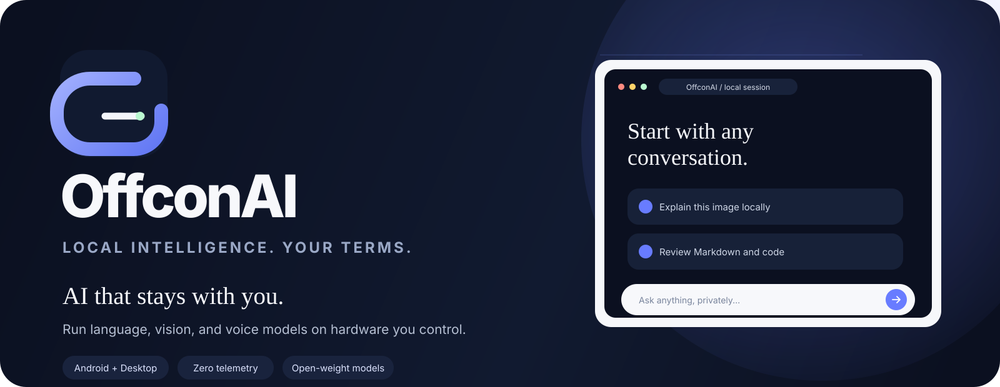
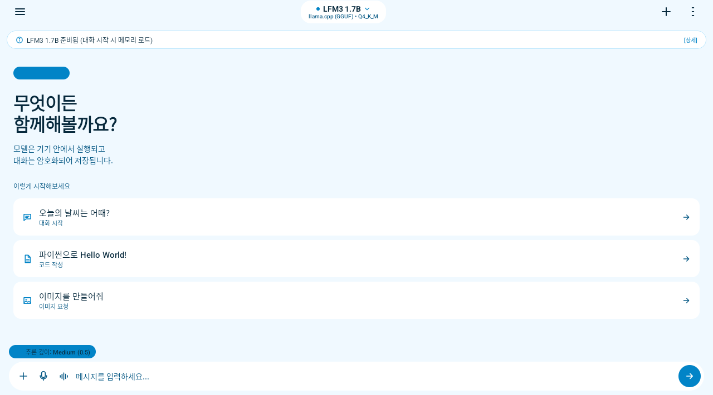
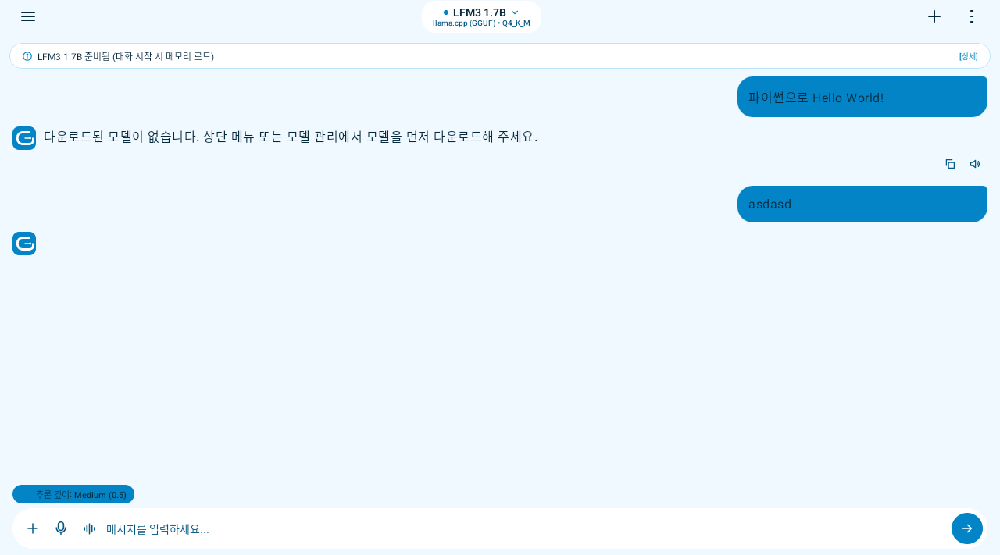
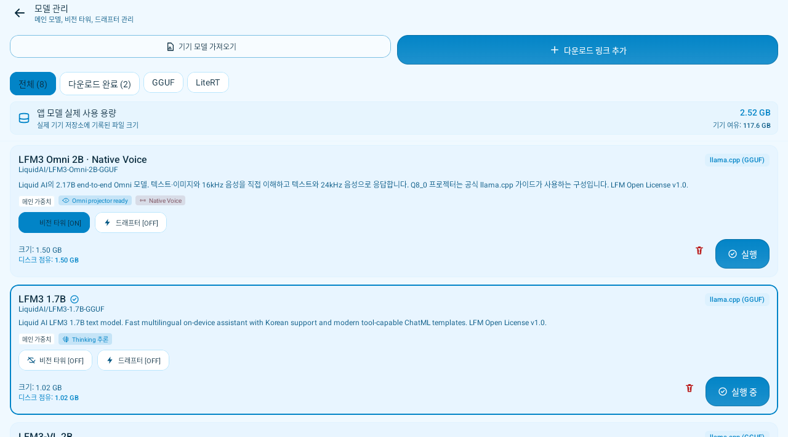
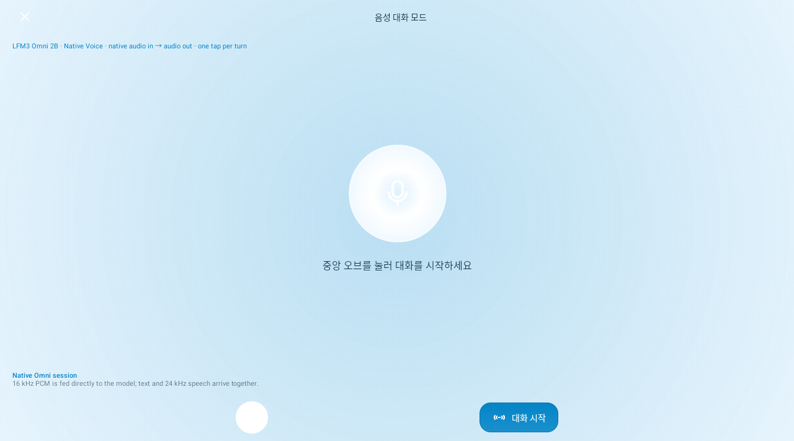

  

  
  
  
  
  
  
  

<h1 align="center">始终陪伴你的 AI。</h1>

  OffconAI 是面向 Android 和桌面的本地优先 AI 工作区。 
  在你自己的硬件上运行语言、视觉和原生语音模型。推理无需账户。

  <a href="#install"><b>下载</b></a> ·
  <a href="#feature-tour">界面</a> ·
  <a href="#models">模型</a> ·
  <a href="https://zmxnpquryet-gif.github.io/OffconAI/"><b>网站</b></a> ·
  <a href="README.md">English</a> ·
  <a href="README.ko.md">한국어</a>

  
  
  

## 从架构开始，就留在本地

OffconAI 让提示词、对话、模型文件和生成过程都留在设备上。只有当你主动下载模型、连接 MCP 服务器或开放可选的本地 API 时，才会使用网络。

| 边界 | OffconAI 的实现 |
| --- | --- |
| **文本推理** | llama.cpp GGUF 与 LiteRT-LM，并提供明确的 CPU 回退 |
| **原生语音** | LFM3 Omni 通过 llama.cpp/libmtmd 运行：16 kHz PCM 输入，文本与 24 kHz PCM 输出 |
| **流水线语音** | 文本和视觉模型可使用设备端 Whisper STT → LLM → TTS |
| **对话存储** | 使用 Android Keystore 的 AES-256-GCM 加密 |
| **本地 API** | 端口 11434 上的 Ollama 与 OpenAI 兼容服务器 |
| **工具调用** | 支持结构化解析与逐次调用审批的 MCP 客户端 |
| **桌面端** | 相互独立的 llama.cpp、vLLM 与 Strata 适配器 |

## 为长时间对话打造的从容界面

| 首页 | 对话 | 原生语音 |
| :---: | :---: | :---: |
|  |  |  |

- **一个输入区，清晰的操作。** 无需离开对话即可附加图片、听写、进入语音模式或发送消息。
- **全主题同步的色彩。** 更改强调色后，Logo、消息气泡、焦点环、控件和状态显示会一起更新。
- **适合流式生成的渲染。** Markdown、代码高亮、表格、链接和易读的数学公式可逐步呈现，同时不执行原始 HTML。
- **真实的运行时数据。** TPS、提示词处理速度、上下文用量、模型格式与加速状态均来自当前后端。
- **自适应布局。** 内容栏在手机、平板、折叠屏和 Windows Subsystem for Android 上保持合适的阅读宽度。

## 没有死胡同的模型目录

| 系列 | 尺寸 | 优势 |
| --- | --- | --- |
| **LFM3 Omni** | 2B | 原生音频与图像输入，支持文本和语音输出 |
| **LFM3 / LFM3-VL** | 1.7B · 2B | 紧凑的多语言文本与视觉能力 |
| **Qwen 3.5** | 0.8B · 2B · 4B | 推理、视觉、工具调用与韩语支持 |
| **Gemma 4 E2B / E4B** | 适合设备运行 | 面向大内存设备的官方 QAT GGUF 构建 |

你也可以通过直链、HTTPS 镜像、Hugging Face 仓库或本地文件添加任何兼容模型。主权重、投影器、草稿模型和提示词模板分别配置。Hugging Face 凭据不会转发给第三方镜像。准确文件、大小和许可证见[模型目录](docs/MODEL_CATALOG.md)。

## 无需中转的原生语音

LFM3 Omni 2B 已接入应用的原生音频路径：

- 16 kHz 单声道 PCM 由多模态投影器编码。
- 音频由语言模型直接评估。
- 原生音频辅助模块输出同步文本与 24 kHz PCM 语音。
- 语音界面会将这条路径与独立的 Whisper STT 流水线明确区分。

当前原生模式会先点按开始录音，再次点按提交一个缓冲轮次。连续双向输入和真实 ARM 设备延迟仍属于待验证目标；应用会明确标注这一限制，不会将其呈现为已完成的功能。

## 建立在可检查的运行时之上

| Android | 桌面端 |
| --- | --- |
| llama.cpp、LiteRT-LM、libmtmd | Java 17 应用 |
| GGUF 与 LiteRT 模型格式 | 独立的 llama.cpp、vLLM 与 Strata 适配器 |
| CPU 回退与能力检测 | LLM Edition 与 All-in-One Edition |
| 带明确状态码的 JNI 桥接 | 后端专属配置与资源监控 |

架构详情：[Android 与平台架构](docs/ARCHITECTURE.md) · [桌面后端](docs/desktop.md)。

## 隐私控制

- 对话与凭据使用 Android Keystore 支持的 AES-256-GCM 加密。
- 可选的 API 服务器默认只绑定回环地址，并要求使用生成的 bearer 令牌。
- 不包含遥测或分析功能。
- 工具调用会等待审批，其输出被视为不可信的外部数据。
- OOM Guard 会在加载模型前估算权重、KV 缓存和计算缓冲区。

## 开始使用

### 安装

下载[最新版本](https://github.com/zmxnpquryet-gif/OffconAI/releases/latest)，允许浏览器或文件管理器安装，然后在模型管理中选择一个模型。

### 构建

~~~bash
git clone --recurse-submodules https://github.com/zmxnpquryet-gif/OffconAI.git
cd OffconAI
./gradlew assembleDebug
./gradlew testDebugUnitTest
~~~

环境要求：JDK 17、Android SDK 36、NDK 27，以及 arm64-v8a 或 x86_64 设备。原生 llama.cpp 子模块固定在上游 v0.8.0，以支持 LFM3。

### 本地 API

~~~bash
curl http://<phone-ip>:11434/v1/models \
  -H "Authorization: Bearer <local-api-key>"
~~~

服务器提供 Ollama `/api/*` 与 OpenAI 兼容的 `/v1/*` 端点。局域网绑定需主动开启；局域网中的 HTTP 流量不加密。

## 项目结构

~~~text
app/       Android 界面、llama.cpp/LiteRT 运行时、语音、存储与 API 服务器
desktop/   Java 17 桌面版本与独立后端适配器
docs/      架构、模型目录、界面方向与 GitHub Pages
~~~

## 参与贡献

更改架构或界面模式前，请阅读 [CONTRIBUTING.md](CONTRIBUTING.md) 与 [docs/UIUX.md](docs/UIUX.md)。变更应保持离线行为，说明已执行的验证，并避免运行时无法证明的能力声明。

## 许可证

Apache License 2.0。模型文件需单独下载，并遵循各自的许可证。
